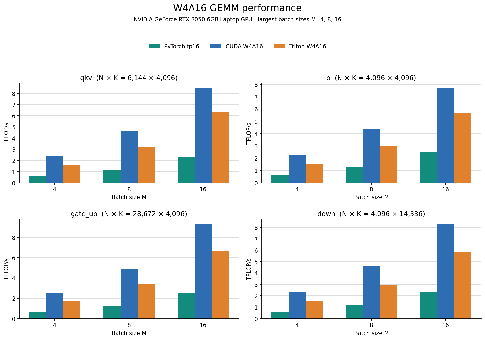

# W4A16 GEMM

CUDA extension for multiplying fp16 activations by group-scaled, packed 4-bit weights:

```text
y[M, N] = x[M, K] @ Wᵀ
W[n, k] = (q[n, k] - 8) * scale[k / G, n]
```

One entry point, `w4a16_gemm(Wp, x, scales, variant=-1)`, with two kernels behind it:

| Path | Used when | Shape contract |
|---|---|---|
| **decode** (`decode.cuh`) | `M` in 1–16 **and** `N % 64 == 0` **and** `K % 512 == 0` | unchanged from before |
| **prefill** (`prefill.cuh`) | everything else (any `M >= 1`) | `N % 16 == 0`, `K % 64 == 0` |

Both take fp16 activations and scales, int32 packed weights (the same format, no repacking), and group size 64 or 128 (`K / groups` must be exactly 64 or 128). `variant` is for testing and tuning: `-1` auto, `0` decode kernel, `1..4` force a prefill tile config (`BM` = 16 / 32 / 64).

The decode algorithm and shape-specific launch configurations are preserved in `decode.cuh`; the new prefill path is selected on the host for batches and dimensions outside the decode contract.

### How prefill works

The packed weight word each lane holds is already an `mma.m16n8k16` A fragment. Prefill swaps the operand roles (tokens become the mma M side, weights the N side). The same eight nibbles then form the B fragments of two n8 tiles, so **the weight format does not change** and the output fragment is already `y[token, n]` (no transpose, no smem reduction). Each CTA computes a `BM x BN` tile over a 3–4 stage `cp.async` pipeline with one `__syncthreads()` per 64-wide k-step; weights are dequantized in registers (one fp16 subtract + one fp16 multiply, bit-identical to the reference). `K` is accumulated sequentially in fp32, so **all four prefill configs produce bit-identical output**, and a row's result does not depend on how many other rows are in the batch (as long as both batches use the prefill path; decode vs prefill differ only by fp32 summation order).

| cfg | tile (BM x BN) | warps (M x N) | layout |
|---|---|---|---|
| 1 | 16 x 64 | 1 x 4 | small batch |
| 2 | 32 x 128 | 1 x 8 | small and medium batch |
| 3 | 64 x 128 | 2 x 4 | two warp groups split across M and N |
| 4 | 64 x 128 | 1 x 8 | BM=64 with all warps assigned across N |

For each config, the host probes the supported 2, 3, and 4 stage pipelines and selects the one with the highest resident CTA occupancy; ties favor more stages. On the tested RTX 3050 (G=128), this selects cfg1: 2 stages/10 CTAs per SM, cfg2: 2/4, cfg3: 3/2, cfg4: 3/2. Set `W4A16_DEBUG_PREFILL=1` to print the selected stage, occupancy, and tile config.

On the RTX 3050 only, auto tile routing uses the measured Llama 3 projection sweep. Other devices use the generic occupancy/work estimate, which has not been performance tuned. The RTX-specific route was within 3% of the fastest forced config in 40 of 44 cases in one sweep; the largest gap was 7.1%. These are single-run measurements and show remaining tuning and timing variability. Use `--variant 1..4` to compare all tiles on a different device.

## Environment and build

The tested reference setup is Ubuntu 24.04 x86_64, Python 3.10.22, PyTorch 2.7.1+cu118, CUDA Toolkit 11.8.89, GCC/G++ 11.5, and sm_86. The GPU used for the results below is an NVIDIA GeForce RTX 3050 6GB Laptop GPU with driver 595.104.02. `environment.yml` and [`requirements-repro.txt`](requirements-repro.txt) pin the Conda and Python packages; `.python-version` records Python.

Install CUDA Toolkit 11.8 and GCC/G++ 11 on the host. From the repository root, create the Python environment and build both extensions:

```bash
conda env create -f environment.yml
conda activate w4a16  # or use your existing akku environment
python -m pip install -r requirements-repro.txt
export CUDA_HOME=/usr/local/cuda-11.8
export CC=/usr/bin/gcc-11
export CXX=/usr/bin/g++-11
export TORCH_CUDA_ARCH_LIST=8.6
nvcc --version
python -c 'import torch; print(torch.__version__, torch.version.cuda, torch.cuda.get_device_name(0))'
python -m pip install -e . --no-build-isolation --no-deps
```

The editable build compiles `w4a16_opt` from `src/vectorized/` and `w4a16_ext` from `src/baseline/`. This setup was rebuilt successfully with CUDA 11.8.89 and GCC/G++ 11.5. Keep the same Python, PyTorch, toolkit, compiler, driver, and GPU architecture when comparing performance.

Run correctness tests from the root:

```bash
python -m pytest -q tests/test_w4a16.py
python tests/layout_prefill.py
```

The GEMM correctness cases execute the CUDA extension on an NVIDIA GPU. Separate host-side checks cover packing and layout helpers; they do not exercise the GEMM kernel. Decode and prefill GEMM cases run on the CUDA GPU and are skipped when CUDA is unavailable. The prefill tests cover ragged batches, output and K tails, both group sizes, all forced tile configs, CUDA graph capture, and comparison with the reference GEMM.

Validation on the RTX 3050: both extensions rebuilt successfully, and `conda run -n akku python -m pytest -q tests/test_w4a16.py` reported 420 passed and 12 skipped. The 12 skipped parameter cases use a K dimension that is not divisible by their requested group size. `python tests/layout_prefill.py` checked 24 shape/config cases (worst relative error 1.3e-15). The torch-free `sm_86` compile check instantiated every retained prefill config; ptxas reported at most 102 registers per thread and zero spill loads/stores.

## Benchmark

Run the three-backend benchmark from the repository root:

    conda run -n akku python benchmarks/bench_gemm.py --md

The default run compares PyTorch fp16 linear, the CUDA W4A16 extension, and the Triton W4A16 kernel across the four Llama 3 8B projection shapes and M in {1, 2, 4, 8, 16}. Both W4 kernels use the same quantized weights, converted to the layout each kernel expects. Timings use CUDA graphs and cycle through a 128 MiB weight working set, with 30 repetitions.

Each run writes timestamped JSON results and a PNG graph under benchmarks/results. The graph has four panels, one per projection, with grouped PyTorch, CUDA, and Triton bars for the three largest requested batch sizes. The saved run shows M=4, 8, and 16. TFLOP/s uses 2*M*N*K / elapsed_time. Pass --json path.json and --plot path.png to choose output paths.

Use --shape N,K (repeatable), --M, --G, --target-mb, and --reps to change the run:

    conda run -n akku python benchmarks/bench_gemm.py --shape 4096,4096 --shape 8192,4096 --M 1,4,16,64,256 --G 64 --reps 50 --md

The Triton launcher is also exposed as a Python function:

    from w4a16_triton import quantize_w4, w4a16_gemm

    weights = quantize_w4(W, G=128)
    y = w4a16_gemm(x, weights)

The Triton function expects fp16 CUDA activations and a W4Weights value returned by quantize_w4. Its packed-weight format differs from the CUDA extension format, so use the Triton quantizer with the Triton entry point.

### Three-backend RTX 3050 run

The measured run is saved as [JSON results](benchmarks/results/three-backend-rtx3050-20261025.json), with its [TFLOP/s graph](benchmarks/results/three-backend-rtx3050-20261025-grouped.png). It contains 20 rows across four projection shapes and M in {1, 2, 4, 8, 16}. Across those rows, measured throughput ranged from 0.12 to 2.54 TFLOP/s for PyTorch fp16, 0.57 to 9.34 TFLOP/s for CUDA W4A16, and 0.37 to 6.66 TFLOP/s for Triton W4A16.



### Previously recorded CUDA benchmark

The results below predate the Triton integration and compare the CUDA extension with fp16 linear; they are historical CUDA measurements.

The historical full run at [`benchmarks/results/baseline-rtx3050-168gbps.json`](benchmarks/results/baseline-rtx3050-168gbps.json) contains 20 rows: four projection dimensions and five batch sizes. After the prefill changes, a decode recheck at [`decode-recheck.json`](benchmarks/results/decode-recheck.json) stayed within 0.44% of that baseline in every row. Values below summarize the baseline run; latency is the measured W4A16 range, speedup compares against fp16 `linear`, and bandwidth is estimated from the benchmark's modeled traffic and latency.

| Projection | N × K | W4A16 latency (µs) | Speedup |
|---|---:|---:|---:|
| qkv | 6144 × 4096 | 83.6–95.5 | 3.64–3.98× |
| o | 4096 × 4096 | 58.6–70.0 | 3.02–3.91× |
| gate_up | 28672 × 4096 | 375.4–403.6 | 3.67–3.84× |
| down | 4096 × 14336 | 198.2–225.9 | 3.56–4.00× |

Modeled bandwidth is shown separately so both tables remain readable:

| Projection | Modeled bandwidth (GB/s) | Of 168 GB/s peak |
|---|---:|---:|
| qkv | 139.3–155.5 | 82.9–92.6% |
| o | 127.3–147.8 | 75.8–88.0% |
| gate_up | 152.6–161.5 | 90.8–96.1% |
| down | 136.6–153.0 | 81.3–91.1% |

Bandwidth is modeled bytes divided by elapsed time, not a hardware DRAM counter. `nvidia-smi` on this laptop reports a maximum memory clock of 7001 MHz. With its 96-bit memory interface and GDDR6's double data rate, that gives about 168 GB/s theoretical peak. The highest modeled value here, 161.5 GB/s, is about 96% of peak. The older checked-in JSON used `--peak-bw 144`, so its `pct_peak` field is relative to 144 GB/s, not the theoretical peak; that baseline run used `--peak-bw 168`.

These archived values come from a prior CUDA-only benchmark run. The PyTorch/CUDA wheel combination follows [PyTorch's official installation instructions](https://pytorch.org/get-started/previous-versions/).

## Repository files

- `src/vectorized/kernel.cu` — host-side validation, dispatch and tile-config selection.
- `src/vectorized/decode.cuh` — decode kernel (M <= 16), unchanged.
- `src/vectorized/prefill.cuh` — prefill kernel (any M).
- `src/vectorized/common.cuh` — shared PTX helpers and the dequant routine.
- `tools/compile_check.cu` — torch-free instantiation of every kernel config.
- `src/baseline/kernel.cu` — baseline CUDA kernel.
- `triton/kernel.py` and `w4a16_triton.py` — Triton implementation and Python entry point.
- `src/*/extension.cpp` — PyTorch extension bindings.
- `tests/` — correctness and packing tests.
- `benchmarks/` — benchmark scripts and saved JSON results.
